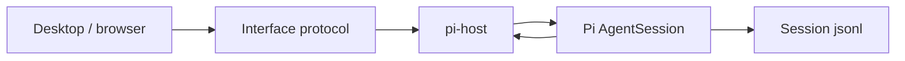
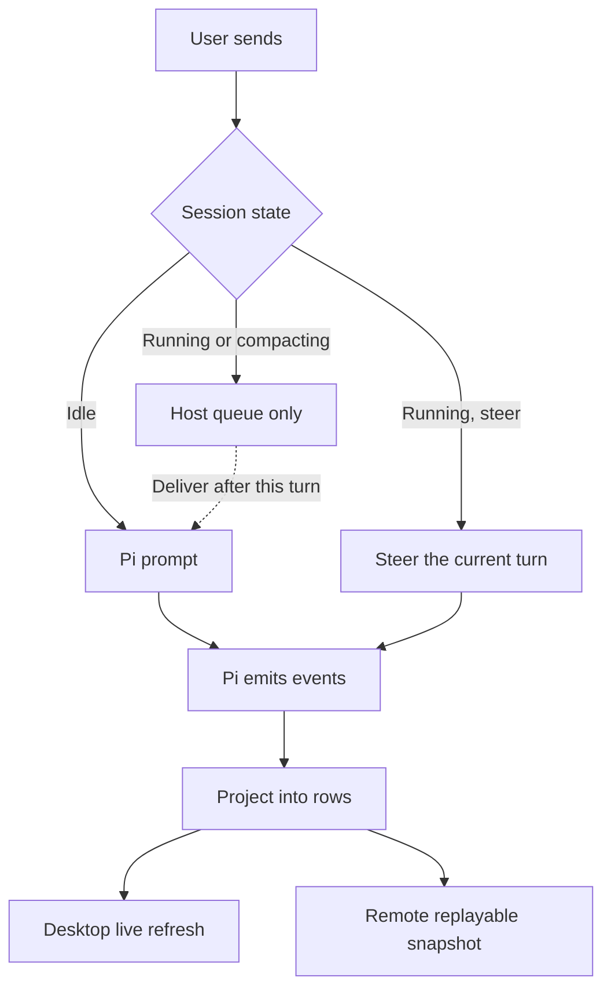
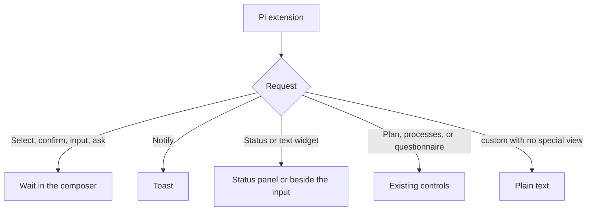

# PiCode

<div align="center">
  
</div>

<p align="center">
  <a href="README.md">简体中文</a> | English
</p>

PiCode is a graphical workspace for [Pi](https://pi.dev). Pi owns the loop, built-in tools, compaction, extensions, and session files. The desktop app and the browser are the interface: read the conversation, answer plugin prompts, and inspect tool results.

Open a project and work with the agent: read code, edit files, and run commands. Each tool call stays in the session.

## What it does

- **Desktop.** An Electron app for opening a local project and working with the agent in a session.
- **Browser.** The same workspace in a browser. `zcode --web` opens it on this machine, without Electron.
- **Shared sessions with Pi.** Conversations are stored in `~/.pi/agent/sessions/`. This repository does not ship a terminal TUI. `zcode` with no arguments only prints help.
- **Pi configuration.** Models, MCP, skills, and plugins come from `~/.pi/agent` and the current project's `.pi`. The settings page can toggle Pi packages and edit an existing plugin config. An open session does not hot-reload; the change applies the next time a session is created.
- **Cards for built-in tools.** `read`, `bash`, `edit`, `write`, `grep`, `find`, and `ls` use the existing read, execute, edit, and search cards. Unknown tools use the generic card.
- **Built-in browser.** This is a host capability, not an installable Pi plugin. A desktop session can drive pages directly.

An extension that only uses Pi's standard UI protocol works without a special adapter: select, confirm, input, notify, status, and text widgets. A `custom()` view with no special renderer falls back to text and does not block the loop.

## How it connects

PiCode does not run its own model loop, and it does not emulate Pi's terminal UI. The desktop and the browser share one interface protocol. `@zcode/pi-host` hands protocol commands to Pi's `AgentSession`, then projects Pi events back onto the screen.



What is different:

- **The session file is Pi's.** The conversation tree lives in `~/.pi/agent/sessions/`, the same files the Pi terminal opens. Rows on screen are a projection and can be redrawn from the file after a disconnect.
- **One projection, two refresh paths.** The desktop follows the live stream. A remote browser reconnect uses a replayable snapshot. The end of a turn is not lost because the link changed.
- **The queue stays in the host.** While a turn is running, a new message is either steered into that turn or queued. It does not start another prompt and take the process down.
- **Tools change only their presentation.** `read` is still Pi's read, shown on the existing read card. Unknown tools use the generic card.
- **No terminal widget tree.** Plugin select, confirm, input, notify, status, and text widgets map onto the dialogs, toasts, and status panel that are already there.

Sending one message:



When a plugin asks for UI:



## Deeply adapted Pi plugins

These are not merely loadable. The host connects each plugin's own commands, events, tool names, or widgets to the plan toggle, questionnaire, and status panel. Install and enable the plugin in Pi. If it is missing or disabled, the matching control stays hidden, or that list stays empty.

| Plugin | What the interface adds |
| --- | --- |
| [`@plannotator/pi-extension`](https://pi.dev/packages/@plannotator/pi-extension) | Plan mode recognizes only this plugin. The composer shows the plan toggle after it is enabled, and `/plan` enters its plan mode first. The `plannotator-progress` widget appears as the to-do list in the status panel, not under the input. |
| [`pi-processes`](https://github.com/Otherworldy/pi-processes-bash) | Owns long-running commands. A running process shows up in the status panel's terminal list, where you can read its log and stop it, without typing `/ps`. Stopping ends that process and does not abort the current turn. |
| [`pi-ask-me`](https://github.com/Otherworldy/pi-ask-me) | The tool name is `ask_user_question`. A call opens a questionnaire card instead of an empty tool card. The question, short header, options, and preview stay separate. |

Subagents are not an adaptation of a Pi plugin. The built-in roles (`scout`, `researcher`, `evidence-auditor`, `worker`, `reviewer`, `oracle`, `delegate`) only follow the division of work from [pi-subagents](https://github.com/nicobailon/pi-subagents). The main session uses PiCode's own `picode_subagent`.

Other extensions use the generic UI. There is no special renderer for `custom()` views.

## Start

You need Git, Node.js **24.14.0**, and pnpm **10.33.2**. Versions come from [mise.toml](mise.toml). Run the commands from the repository root.

```bash
pnpm bootstrap
pnpm dev:desktop
```

`pnpm bootstrap` installs dependencies and prepares local runtime assets. `pnpm dev:desktop` starts the desktop app.

For the browser and backend only:

```bash
pnpm dev:web
```

Open <http://localhost:5173>. The service behind it listens on <http://localhost:3030>.

After the command-line package is installed or built, from a project directory:

```bash
zcode --web
```

`zcode` with no arguments only prints help.

## Where the code is

| Directory | Contents |
| --- | --- |
| `packages/desktop` | Desktop app |
| `packages/web`, `packages/server` | Browser UI and local service |
| `packages/ui` | UI shared by desktop and browser |
| `apps/zcode-cli` | CLI. `zcode --web` and the `app-server` the desktop starts |
| `apps/zcode-cli/packages/pi-host` | Pi sessions, tool presentation, plugin UI, and the adapters above |

## License

The code in this repository is [Apache-2.0](LICENSE). PiCode continues from Zhipu's open-source [ZCode](https://github.com/zai-org/ZCode). See [NOTICE.md](NOTICE.md) for feature boundaries, data risks, and third-party notices.
