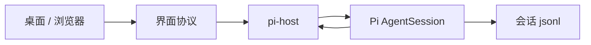
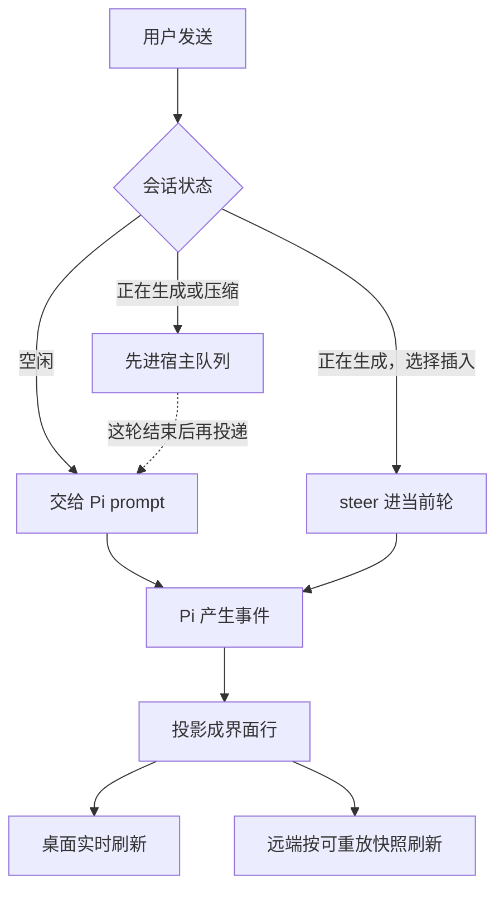
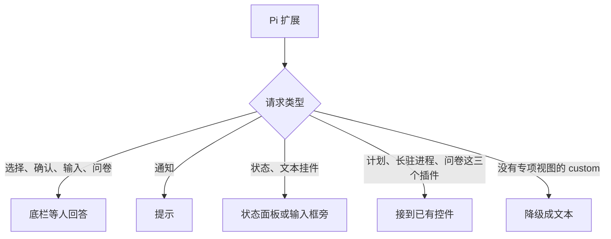

# PiCode

<div align="center">
  
</div>

<p align="center">
  简体中文 | <a href="README.en.md">English</a>
</p>

PiCode 是 [Pi](https://pi.dev) 的图形工作台。循环、内置工具、压缩、扩展和会话文件都由 Pi 负责。桌面应用和浏览器只做界面：看对话、回答插件提问、看工具结果。

打开一个项目，和 Agent 一起读代码、改文件、运行命令。每次工具调用都留在会话里。

## 能做什么

- **桌面应用。** 用 Electron 打开本地项目，在会话里和 Agent 协作。
- **浏览器。** 同一套工作台跑在浏览器里。`zcode --web` 在本机打开它，不需要 Electron。
- **和 Pi 共用会话。** 对话写在 `~/.pi/agent/sessions/`。本仓库不提供终端 TUI。不带参数的 `zcode` 只打印帮助。
- **配置跟着 Pi 走。** 模型、MCP、技能和插件读 `~/.pi/agent`，以及当前项目的 `.pi`。设置页可以开关 Pi 包、改已有的插件配置。已打开的会话不热更新，下次新建会话才生效。
- **内置工具有卡片。** `read`、`bash`、`edit`、`write`、`grep`、`find`、`ls` 用现有的阅读、执行、编辑和搜索卡片。不认识的工具走通用卡片。
- **内置浏览器。** 这是宿主能力，不是可安装的 Pi 插件。桌面会话可以直接操作页面。

只会用 Pi 官方界面协议的扩展不用专项适配也能用：选择、确认、输入、通知、状态和文本挂件。没有专项界面的 `custom()` 视图降级成文本，不卡住循环。

## 怎么接

PiCode 不另跑一套模型循环，也不仿真 Pi 的终端界面。桌面和浏览器共用一套界面协议。`@zcode/pi-host` 把协议命令交给 Pi 的 `AgentSession`，再把 Pi 的事件投回界面。



特色是这几条：

- **会话文件就是 Pi 的。** 对话树写在 `~/.pi/agent/sessions/`，和 Pi 终端打开的是同一份。屏幕上的行是投影，断线后可以按文件重画。
- **一份投影，两种刷新。** 桌面跟着流式输出走；浏览器远端重连走可重放快照。终态不会因为换了一条链路就丢掉。
- **队列在宿主。** 这一轮还在跑时，新消息要么插进当前轮，要么先排队。不会再开一次 prompt，把进程打退出。
- **工具只改显示。** `read` 仍是 Pi 的 read，卡片用原来的阅读卡。不认识的工具用通用卡。
- **不画终端控件树。** 插件的选择、确认、输入、通知、状态和文本挂件，映到已有的弹窗、提示和状态面板。

发一条消息时：



插件要界面时：



## 深度适配的 Pi 插件

下面这些不是「能加载」而已。宿主按插件自己的命令、事件、工具名或挂件，接到计划开关、问卷和状态面板上。插件要在 Pi 里安装并启用。没装或关掉时，对应入口不出现，或那一份列表是空的。

| 插件 | 界面上多出来的行为 |
| --- | --- |
| [`@plannotator/pi-extension`](https://pi.dev/packages/@plannotator/pi-extension) | 计划模式只认这个插件。启用后输入框才有计划开关；`/plan` 会先进入它的计划模式。进度挂件 `plannotator-progress` 出现在状态面板的待办里，不铺在输入框下面。设置里的「显示待办」打开后，同一份清单以抽屉贴在输入框上方。 |
| [`pi-processes`](https://github.com/Otherworldy/pi-processes-bash) | 长驻命令的主人。正在跑的进程出现在状态面板的终端列表里，可以看日志、停止，不必打 `/ps`。停止只结束该进程，不中断当前对话。 |
| [`pi-ask-me`](https://github.com/Otherworldy/pi-ask-me) | 工具名是 `ask_user_question`。调用后打开问卷卡，而不是一张空的工具卡。问题、短标题、选项和示意分开显示。 |

子代理不是对某个 Pi 插件的适配。内置角色（`scout`、`researcher`、`evidence-auditor`、`worker`、`reviewer`、`oracle`、`delegate`）只是沿用了 [pi-subagents](https://github.com/nicobailon/pi-subagents) 的分工。主会话用 PiCode 自己的 `picode_subagent`。

## 开始

需要 Git、Node.js **24.14.0** 和 pnpm **10.33.2**。版本以 [mise.toml](mise.toml) 为准。命令都在仓库根目录执行。

```bash
pnpm bootstrap
pnpm dev:desktop
```

`pnpm bootstrap` 安装依赖并准备本地运行资源。`pnpm dev:desktop` 启动桌面应用。

只看浏览器和后端时：

```bash
pnpm dev:web
```

打开 <http://localhost:5173>。背后的服务在 <http://localhost:3030>。

<a id="zcode-命令行版"></a>

装好或构建出命令行包之后，在项目目录里可以：

```bash
zcode --web
```

不带参数的 `zcode` 只打印帮助。

## 源码在哪

| 目录 | 内容 |
| --- | --- |
| `packages/desktop` | 桌面应用 |
| `packages/web`、`packages/server` | 浏览器界面和本地服务 |
| `packages/ui` | 桌面和浏览器共用的界面 |
| `apps/zcode-cli` | 命令行。`zcode --web` 和桌面拉起的 `app-server` |
| `apps/zcode-cli/packages/pi-host` | Pi 会话、工具呈现、插件界面和上面的专项适配 |

## 许可

本仓库代码采用 [Apache-2.0](LICENSE)。PiCode 基于智谱开源的 [ZCode](https://github.com/zai-org/ZCode) 继续开发。功能边界、数据风险和第三方声明见 [NOTICE.md](NOTICE.md)。
