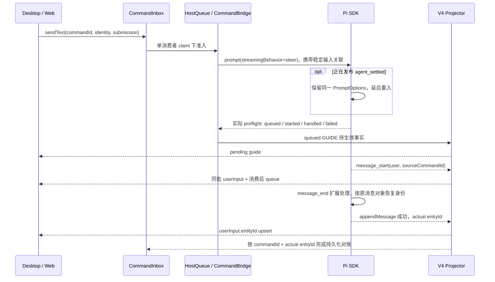
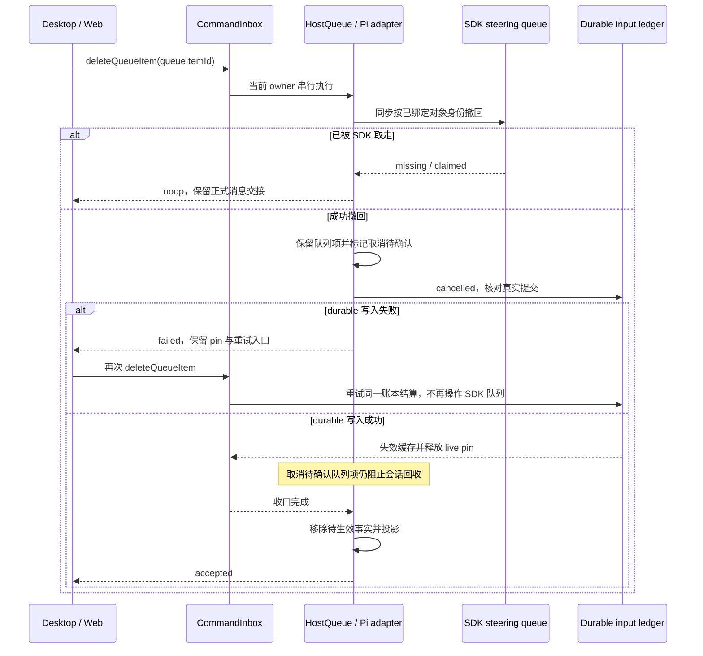

# Pi 引导输入的可见性与消费交接

## 行为与范围

桌面端已有会话运行中发送 GUIDE 输入，准入成功后必须立即在时间线显示“引导待生效”；Pi 消费后由正式用户消息接管，正文只出现一次。模型、附件或 SDK input handler 异步准备期间，原轮次结束时必须按 SDK 的实际状态启动新轮，不能向空闲 Pi 留下无人消费的 steering 输入。

本次修复 Pi Host 输入准入、SDK 适配及 V4 投影交接。复用现有 pending guide UI、CommandInbox、HostQueue 和订阅通路，不新增 Renderer accepted queue，不改变普通排队、暂停、手动提升、工作区身份或 owner/lease 的语义。既有无身份元数据的历史仍可读取。

## 所有权与接口契约

- CommandInbox 负责 commandId 幂等准入与 durable input intent/live pin。
- HostQueue 是 PiCode 已接纳但尚未物化输入的唯一所有者；GUIDE 已交付 SDK 时的条目只是这一输入的权威生命周期事实，不能再被普通 drain、改写、重排或提升重复消费。用户可通过既有 `deleteQueueItem` 撤回尚在 SDK steering queue 中的单条 GUIDE，必须先按 Host 身份同步撤回实际消息，再移除待生效事实；已被 SDK 取走的消息不可撤回。
- Pi AgentSession 持有执行、输入扩展、模板展开和实际 steering 消费。适配器保留 SDK 的 started/queued/handled 结果，不能把 queued 伪报为已启动新轮。
- SDK 适配器在实际用户消息对象的交付边界关联 sourceCommandId/clientId；不得按正文匹配，也不得按任意 user message 的到达顺序猜测身份。相同文本、扩展转换、扩展自产输入仍正确关联；身份元数据不能进入用户正文。SDK 在 `agent_settled` 内延后重新调用 prompt 时，沿用该次显式提交身份并等待真实 preflight；扩展自产输入仍隔离。`message_end` 扩展替换用户消息后，在最终 appendMessage 前恢复同一消息对象的 Host provenance。
- PiToV4Projector 只投影权威事实。消费事件携带稳定身份，正式 userInput 与移除对应 pending guide 在同一批 delta 中发布；用户行保留 sourceCommandId/clientId 和对应附件。
- 已交付 SDK 的 GUIDE 在模型错误或中止后仍未消费时继续可见，不由 Host 再次 prompt；它不阻塞后续普通 queued 项的 FIFO 消费，恢复自动消费由普通项启动 SDK 并让 SDK 自行消费已有 GUIDE。SDK 返回 handled 时移除待生效事实、收口命令；明确失败时清理本次 provisional 状态并向发送者返回失败，不丢弃其草稿。
- 已物化输入的 ledger/live pin 按 sourceCommandId 收口。`message_start` 只证明消费，不证明落盘；等 SessionManager 分配实际 entryId 后更新 userInput.entityId，账本只能在这次 upsert 后标记 promoted 并释放 live pin。保持既有 workspaceIdentity、remoteSessionId 及命令作用域。

Desktop `desktop-continuous` 与手机 `web-remote-replayable` 从同一个 Host owner、同一条序列接收结构性 queue/userInput 变化。重新订阅的 snapshot 仍显示尚未消费的 GUIDE；长轮次继续使用既有 wireTailRows 锚点保护。不得用定时器或重发命令掩盖交接缺口。

## 验收场景

1. 真实 SDK 在可控模型流阻塞时接收 GUIDE：ACK 后 pending guide 包含原正文和身份；Host 不重复 drain；释放流后正式用户行恰好一条，pending 同批退出。
2. 同一运行轮产生超过 60 行后发送 GUIDE，continuous 与 replayable 的实时帧、恢复快照及消费后尾窗均能找到待生效项或正式 userInput。
3. 模型/附件准备或异步 input handler 跨过原轮次结束：只启动一次新轮，SDK 无孤立 steering 输入。
4. 多次同文 GUIDE，以及 input handler 转换正文：各命令按稳定身份独立消费，不能误认扩展自产 user message。
5. SDK input handler 返回 handled：不保留 pending guide，不等待不存在的用户行；保存成功命令事实后终结 admitted input 并解除 live pin。SDK 拒绝或附件失败则清理 provisional 状态并保留发送者可重试草稿。
6. SDK 已接收但未消费的 GUIDE 在错误/中止及重新读取时保持可见，普通 Host queue 消费、编辑、删除、重排和手动提升均不能重复交付它。
7. 原有 ordinary queue consumer claim、idle-only admission、暂停和失败回滚测试继续通过；用户行身份在 JSONL 冷恢复后保留，ledger/live pin 能按同一 commandId 收口。
8. `agent_settled` 内的显式 Host 发送延后执行时，ACK 等真实 preflight，运行 completion 等真实执行完成；身份和附件仍对应原命令。
9. `message_end` 扩展返回只含标准字段的替代用户消息时，JSONL 仍保留 Host 输入身份；写盘失败不能生成持久化确认或解除 live pin。

## 待生效引导的取消

- 每条待生效 GUIDE 提供“取消引导”入口，桌面和手机均可直接发现；只读视图不提供入口。复用 `deleteQueueItem` 命令和当前会话的 workspace / owner / lease 路由，不增加 Renderer accepted queue。
- 取消仅影响指定 sourceCommandId + clientId 的 SDK 原始消息。两个相同正文、图片、扩展改写、扩展自行排入的 steering / follow-up 输入保持独立；不中止当前运行，不清空整个 SDK 队列，也不重新运行 input handler。
- 尚在 submitting 的 GUIDE 沿用 reserved 拒绝反馈，不能误报成已消费；仅 steering 状态可进入撤回流程。普通 FIFO consumer 不会取走 reserved GUIDE，其占用不阻止撤回这条已交付 SDK 的消息。
- SDK 原始 steering queue 中的消息对象是取消与消费竞争的裁决点。同步取回该对象后才允许删除 HostQueue 事实。SDK 已 drain 但 `message_start` 尚未发布时也算消费获胜，取消返回 noop，不隐藏或伪造成功撤回；在 `turn_end` 后 SDK 重新轮询队列之前，若取消先撤回最后一条 GUIDE，不应触发无输入的额外模型轮次。
- 取消失败时用户可重试账本收口；`cancelSettlementPending` 随 HostQueue 在内存中保留，不写回 SDK、不自动补发。durable cancelled 提交后，gateway 先失效缓存并释放对应 live pin；HostQueue 的待确认条目仍是会话 residency barrier，handler 随后移除它并发布最终投影。CLI 重启仍遵循已有 admitted 输入恢复规则：将未收口输入标记 discarded，并提示用户确认后重发。
- SDK 1.5.0 无按身份删除单条 steering 输入的公共 API。兼容访问仅限 Pi Host 的一个适配边界，校验实际队列结构，按已绑定的消息对象身份删除；文本展示镜像只在有可对应项时尽力同步，镜像缺项不阻止物理撤回。SDK 结构不匹配时明确失败，不能退化为按正文取消或 clear-all。队列更新监听器同步抛错不改变已经完成的撤回，HostQueue 与账本仍须继续收口，避免留下不可重试的幽灵条目。

验收场景包括 continuous/replayable、one-at-a-time/all、同文仅撤回其中一条、错误 client 隔离、扩展改写及自产输入、附件、停止后尚未消费的 GUIDE、SDK 已 claim 但事件延迟、重复取消、持久化失败保留 pin，以及取消后继续运行 / 快照恢复不出现被取消正文。具体已执行证据见下方取消专项。

### 取消专项验证

- Pi Host 取消专项 8/8 通过，其中真实 SDK 场景覆盖四种 profile / steering mode 组合、同文及附件、扩展输入、错误 client、重复取消、drain 后事件延迟、`turn_end` 边界取消不触发额外轮次、停止后取消及普通 FIFO 恢复；适配器回归另覆盖文本展示镜像缺项仍按对象身份撤回。四种组合还验证了 SDK 队列更新监听器确实同步抛错后，撤回与 Host 事实仍能一致收口。
- Bootstrap 相关回归 66/66 通过，包含真实 `deleteQueueItem` handler 的成功、重复、SDK 已 claim、durable 失败及失败后重试；也覆盖 submitting 时拒绝撤回、普通 consumer 占用期间撤回已入队 GUIDE，以及精确账本 ID / 身份、提交读回和 live pin 释放顺序。
- UI 组件测试 6/6 通过，覆盖 submitting 隐藏取消入口、账本收口失败后的可重试状态、只读视图与中英文标签。隔离浏览器使用真实组件与 SDK，验证同文两条仅撤回第二条、只读无入口、继续运行与重读快照后不复活。浏览器控件用 DOM 点击事件触发 React handler，未验证原生指针点击；服务直接接 Host bridge，完整命令与账本边界由 Bootstrap 回归覆盖，不等于完整 Electron 端到端验收。
- Pi Host 全套实测 469/470，唯一失败为下述已确认的 file-rewind 基线用例；本次取消专项用例均通过。根及受影响包类型检查、lint、架构检查和本次文件格式检查均通过，lint 存在既有 warnings。

## 验证

已执行：

- Pi Host 完整测试 417/418 通过。唯一失败为 `file-rewind.test.ts` 的 `short execution args do not drop earlier edits from the file count`，修改前 HEAD 隔离重跑同样失败。GUIDE 专项及 consumer claim 回归通过，覆盖本次 settled 延后执行、替换消息与中止后普通 FIFO 恢复。
- Bootstrap 相关测试 59/59 通过，覆盖实际准入回执、reserved GUIDE 提升保护及普通 FIFO 恢复、真实 entryId 对账、真实 SDK 写盘失败仍保留 live pin、同文与跨会话隔离、handled 成功事实及既有 queue/residency 行为。
- Pi Host、Bootstrap 包类型检查及仓库 `pnpm typecheck` 通过；`pnpm lint` 通过（87 warnings、0 errors），两个受影响包额外执行忽略规则之外的 lint，均为 0 errors；架构检查 0 violations。
- 真实 Pi SDK 1.5.0 分别验证 continuous/replayable、one-at-a-time/all steering、65 次工具调用后的同文 GUIDE、异步 input handler 跨 busy→idle、input/before_agent_start 扩展改写与自产输入、agent_settled 延后执行与实际运行 completion、message_end 替换消息后恢复 provenance、模型错误和中止后的普通 FIFO 恢复、JSONL 身份恢复及实际持久 entryId 回写。
- 隔离浏览器 fixture 使用真实 SDK 和现有消息组件：发送后输入框清空、正文显示待生效；释放当前运行后 pending 退出、正式正文恰好一条。此项不等于完整桌面应用端到端验收。
- 桌面 Agent 构建与 bundled-agents 暂存成功。2026-11-13 已使用 `pnpm dev:desktop:prod` 启动真实 Electron 桌面与已配置模型完成验收：65 次独立工具调用后的同轮发送两条同文 GUIDE，输入框清空后两条待生效正文均可见；消费后正式正文各一条、pending 为 0。JSONL 中两个 sourceCommandId 独立，ledger 均为 promoted 且 promotedMessageID 与实际 entryId 一致。
- 真实桌面停止/恢复验证：运行中 GUIDE 和普通排队消息同时存在，停止后普通队列暂停，点击“继续”后成功执行，两条输入各保留一条。此次 SDK 在 abort 收尾时已经消费 GUIDE，未覆盖“abort 后 GUIDE 仍 reserved”的桌面分支，该分支由真实 SDK 回归覆盖。
- 刷新窗口及完整停止/重启开发版桌面后重新打开验收会话，两条同文 GUIDE 仍各一条、pending 为 0，停止/恢复场景的两条输入也都保留。两次桌面 Agent PID 不同；CLI 与暂存 bundle 的 SHA-256 一致。截图、DOM 快照和持久化对账证据存放在 `D:/tmp/picode-guide-desktop/`。已安装版用户工作会话保持运行。
