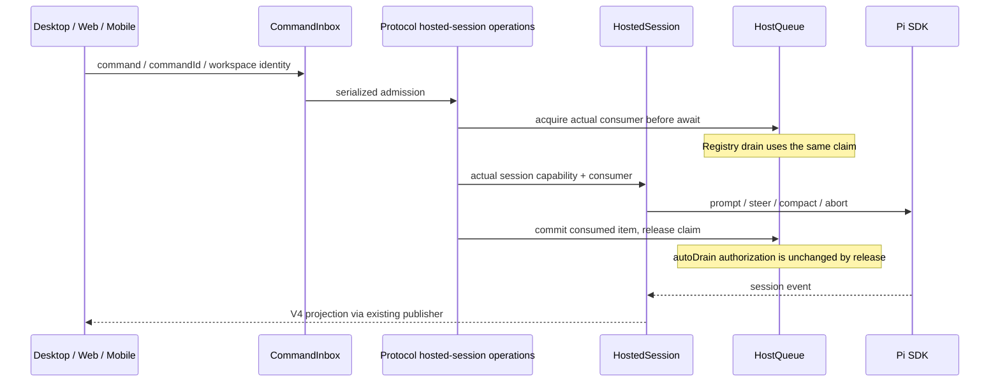

# Pi 协议路径移除旧 ZCodeApp 门面

## 范围

PiCode 的 Pi 会话协议路径不再通过 `createPiHostedApp` 把 `HostedSession` 伪装成 `ZCodeApp` / `AgentRuntime`。删除这条门面及仅为满足旧接口而制造的完成结果、固定 idle 投影、空 reservation / promotion 实现。现有独立旧 Core 的 `createZCodeApp` API 及其实际调用者不在本次删除范围内。

这是接口与调用路径收缩，不迁移 Agent 进程，不改变 wire schema、队列调度所有权或已有产品行为。禁止用换名后的旧接口或双重类型断言继续伪装完整 Core runtime。

## 所有权与契约

- Pi `AgentSession` / `SessionManager` 继续持有执行与持久化上下文；`HostedSession` 是 Pi 会话能力入口。
- `HostQueue` 继续持有 PiCode 已准入输入，`CommandInbox` 继续负责外部命令的准入、串行化与幂等。保留当前 Registry drain / V4 promotion 的事件顺序，本次不另起调度者。
- `PiToV4Projector` 持有界面投影；协议直接读取该事实，不再制造旧 Core 的固定 idle 投影。
- 协议记录显式暴露 hosted session。现有非 Pi / 测试嵌入路径如仍需要旧 Core，必须通过可区分的真实契约保留，不要求 Pi 实现不存在的能力。
- 文件回退、附件 IO、模式持久化、标题与历史恢复属于真实应用行为，应保留在清晰的协议应用操作中；不为它们引入新的总门面。
- 发送回执表示准入结果，执行完成使用真实 `Promise<void>` 或现有真实结果。不得用 sessionId 冒充新的 turnId 或构造空 `TurnResult`。
- 模型事实读 `HostedSession.getCurrentModelSelection()`；busy / 常驻回收读 hosted session 的实际事实。扩展命令、设计模式、插件通知、后台工作等直接使用类型明确的能力，移除 `app as { piHosted?: ... }` 逃生口。

Desktop `desktop-continuous` 与手机 `web-remote-replayable` 仍从同一会话所有者与序列得到各自交付；owner / lease / stale-run 防护和 `workspaceIdentity?.trim() || workspacePath` 规则不变。

## 失败与生命周期

- Pi 拒绝准入时返回现有失败，不虚构已启动回合；扩展命令仍返回 handled，不提升草稿持久化。
- 忙时发送、guide、暂停队列及手动立即发送沿用当前语义；不能用删除占位接口为由悄悄改变调度。`HostQueue` 持有真实的单消费者 claim，Registry drain、V4 提升、立即发送与普通 prompt 准入在第一个 await 前取得它，直到准入完成才释放。Registry 已开始读取模型/附件时，手动提升以 `guard.queuePromotionBusy` 拒绝；消费占用期间的删除、改写和重排以 `guard.queueItemReserved` 拒绝，避免外部命令更改在途提升已经读取的队列事实；普通输入可以排队但不能超车或 steer。claim 是消费占用，不改变 `autoDrain` 授权；释放必须幂等且不能覆盖用户或 compact 失败写入的暂停。自动提升遇到在途 claim 后在释放边界重新评估，复用现有 V4 ready 路径，不新增轮询或调度者。
- 提升以原 sourceCommandId 和完整 intent 使用 idle-only admission：异步模型/附件窗口后 busy 必须在 enqueue/steer 前拒绝，saved guide intent 不能改变这一约束。准入前失败保留原项；idle-only 扩展须完成附件准备及最终 busy 检查，调用 Pi 后才返回 handled，扩展问答完成仍通过另一条 RPC 等待；prompt/handled 已准入或 compact 后台操作已登记后移除原项且检查移除结果，执行期失败不重新插入已准入项。Registry/V4 保留原消费职责，不引入第二份队列。
- 文件回退保留当前安全检查、事务补偿及 `commitAfterApply` 顺序；历史裁切失败仍恢复原投影。相对工具路径以 `HostedSession.cwd` 为基准解析，worktree/子目录会话不得检查或改写 workspace 根目录的同名文件；SSH 继续通过现有远程路径映射读取和写入。
- Pi 附件落盘引用必须逐次唯一且以独占写入创建；不同会话同毫秒上传清洗后同名文件仍保留各自字节，后续发送和预览必须读取原附件。
- 模式修改必须同步现有持久化路径。协议资源所有者跟踪真实 hosted session，关闭返回可复用的 Promise，等待扩展 shutdown 与 SDK dispose 完成；取消订阅只负责断开事件。创建操作在第一个 await 前登记到资源 owner，shutdown 先禁止新增创建并等待在途创建、绑定及其失败释放全部完成，再允许关闭共享存储/MCP。创建/恢复跨 await 后重新检查服务状态，关闭后迟到的会话以及绑定失败的会话均释放且不得留在注册表。resident 回收、冷恢复及请求结束后的收尾不能丢失。
- 历史首次恢复只填充空投影；普通 snapshot/read 不重放已有行，避免清掉内存反馈、回退标记和当前分支。异步读取 jsonl 后重新检查空闲与空投影条件，读取期间开始的新轮次不得被旧历史覆盖。
- 旧 Core 独有且在 Pi 上从未实现的能力不得伪装成功；使用现有不可用语义或显式能力边界。

## 验收

1. 新建 / 恢复的 Pi 协议记录可直接访问同一个 HostedSession；不调用 `createPiHostedApp`，不依赖 `ZCodeApp.runtime`，不含 `as unknown as ZCodeApp`。
2. 真实消息发送、忙时入队、guide、附件、扩展 handled 与完成收尾仍走当前会话，回执不含虚构 `TurnResult`。
3. 模型 / 思考等级、完全访问、设计模式、扩展问卷与通知、标题与子代理能力仍可用，不经 `piHosted` 强转。
4. Stop / compact / close / resident 回收仍使用真实 busy 与生命周期；保持 Desktop 和 replayable 交付。
5. 文件回退成功与失败补偿、历史恢复保留原行为；相对路径在独立 worktree/子目录内恢复或删除，workspace 根目录的同名文件保持原字节。
6. 相同时间戳、清洗后同名附件在同一会话和不同会话并发上传均返回不同 ref，发送和预览读取各自字节。
7. SDK 创建或绑定存储读取挂起时，shutdown 保持 pending；创建返回后的真实 dispose 完成、绑定收尾结束后才完成关闭，迟到会话不登记。
8. 独立旧 Core API 的实际调用者仍可类型检查；不顺带恢复已移除产品功能。
9. 模型检查后变 busy 的提升不入队、不 steer，原项保持一份；并发提升和已在读模型的 Registry drain 不能重复消费或超车。compact 立即失败时后续项保留且 `autoDrain=false`，释放消费 claim 不重新放行。

## 验证入口

- 新增 / 更新 Bootstrap 中针对 hosted session 准入、扩展 handled、模式持久化与实际生命周期的回归测试，先补测试再实施。
- 执行受影响 Bootstrap / Pi Host 测试与各包类型检查。
- 执行仓库 `pnpm typecheck`、`pnpm lint` 和 `pnpm architecture:check --changed`，分别记录真实结果。
- 此改动不增加 UI 行为；复用协议集成场景验证已有交互，不新增界面测试框架。
