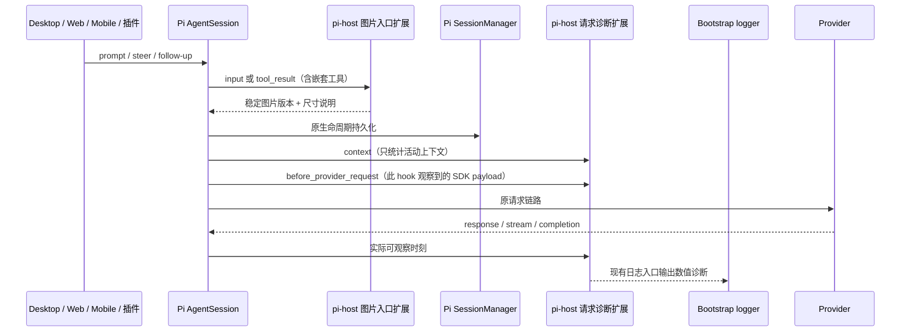

# Pi 会话图片压缩与请求计量

## 范围与规则

首版控制新图片的重复传输成本，并量化当前活动请求。统一覆盖普通 prompt、steer、follow-up、Read、MCP/截图和嵌套工具，以及主会话和子代理。不按图片张数或字节触发自动 compact，不省略历史图片，不改写已有 JSONL、分支或 UI 恢复策略。

- 复用当前启用 Pi SDK 的公开 `resizeImage` / `formatDimensionNote`，不替换 Read 或另建图片编码器。
- 默认单图 base64 上限为 512 KiB，宽高上限 2000，JPEG 起始质量 80；取 hook 当时可见的所选模型声明与默认上限中更严格的值。虚拟模型的后续路由、图片入队后的模型切换不由这个入口 hook 保证；普通 prompt 和工具结果仍接受 SDK 后续校验，steer/follow-up 不再经过相同归一化。先重新编码、再降质量、最后缩小尺寸，具体由 SDK 执行。不把该预算宣称为已验证的最佳值。
- 在 SDK `input` 与 `tool_result` 生命周期处理新图片，补齐 steer/follow-up 的归一化缺口。处理结果沿原链路入历史并复用；不在每次请求中重新压缩历史图。普通 prompt 和工具结果仍可能被 SDK 再次解码、校验，不能宣称图片总共只处理一次。`images.autoResize=false` 跳过本扩展处理，SDK 仍可能转换其不支持的格式，不承诺任意格式的原字节透传。
- 转换附上 SDK 的尺寸映射说明，保持坐标可换算。只有像素尺寸实际变化时添加说明；仅更换编码不追加 1 倍缩放提示。Read 如果已经经过 SDK 缩放，后续再次缩小时合并映射为源文件到最终图片的一条说明。
- 保留原附件/工具源文件；不写入源文件。模型历史中的图片可使用压缩版本。
- 扩展转换失败保留原图片交回 SDK，并输出不含图片内容的诊断；沿用 SDK 后续校验语义：普通 prompt 若仍无法解码，会省略无效图片并保留失败文字提示；Read 在本扩展前就可能返回无像素的失败文字；直接产图工具的失败图片保留。不能将无像素结果伪装成成功，或依赖扩展抛错实现硬上限。512 KiB 是成功处理时的目标，不是失败时强制拒绝阈值。
- 不改变工具名称、调用 ID、结果配对、文字内容和顺序，不新增依赖或用户设置界面。Read 的结构化图片返回值同步替换为压缩版本及更新后的尺寸说明，保证 codemode/嵌套调用仍拿到图片；无法判断映射的自定义结构化结果保留原值，不能因模型侧重新编码就使程序调用丢失返回结构。未知结构里重复携带的图片不承诺受本扩展模型侧预算约束。

## 所有者、接口与时序

Pi AgentSession / SessionManager 仍是执行和持久历史的唯一所有者。pi-host 注册两个共享扩展：图片入口处理和请求诊断。主会话及子代理复用同一实现；诊断通过可选 typed callback 交给 Bootstrap 现有 logger，避免 pi-host 跨包引用服务日志实现。

Desktop `desktop-continuous` 与手机 `web-remote-replayable` 复用同一 Host，不改变协议、队列准入、owner/lease、workspace identity 或恢复机制。异步图片处理沿原 SDK input/tool await 顺序完成，不增加轮询、第二队列或另一个历史缓存。

## 计量与日志契约

- 区分活动上下文图片数量、base64 字节和此 hook 观察到的 SDK provider payload 的 UTF-8 JSON 字节。整份会话 JSONL 大小不作为请求大小。后续 handler 或 provider 适配器仍可改变最终发送体；本地集成测试证明当前 OpenAI-compatible 路径的观察值与收到的 JSON 一致，不泛化为所有传输。`contextImageCount` / `contextImageBase64Bytes` 在 `context_with_system` 阶段计量；后续 SDK 的禁图或模型兼容转换可能进一步减少它们，不将此值冒充 provider 格式里的图片数量。
- `pi_host.provider.request` 输出 `prepared` 与 `settled` 两种阶段；用 `observerId` + `requestIndex` 关联，observer 重载后也不与旧记录混淆。prepared 的关联暂定，settled 是最终归属；发生交叠时 settled 会清除已无法可靠关联的上下文与时序字段，但保留 prepared 选定的 info 可见性。`payloadJsonBytes` 为 SDK payload JSON UTF-8 字节，`payloadMeasurementMs` 为本次计量耗时；没有声称包含 HTTP headers、WebSocket envelope 或网络压缩大小。
- `firstContentMs` 记录首个非空 thinking/text/工具参数 delta，或首个可观察到工具名称/ID 的工具事件；具备元数据的 `toolcall_start` 已算内容，不等待参数增量，空的开始事件不算内容。`firstTextMs` 单独记录首个文本 delta；没有文本的工具调用不填写首文本时长。provider 首事件到来后才将 `modelSource` 改为 `provider_event`，此前 `selection` 表示当前选择。`configuredTransport` 记录配置选择，不冒充实际握手结果。
- 记录实际启用 SDK 版本、provider/model、session ID（子代理带父 ID）、会话内请求序号。用量计数使用 `usage.input` / `output` / `cacheRead` / `cacheWrite` 数值字段，避免现有脱敏器将带 `Tokens` 的字段名误判为凭据；不改动通用脱敏规则。只记录数值、状态和已有路由标识；不记录正文、base64、headers、凭据或文件路径。
- 可观察阶段包括本扩展图片处理耗时/前后字节/成功失败、上下文计量、payload 序列化计量、payload hook 后到响应头/首 provider 事件/首内容的时长，以及调用结束时长。`pi_host.image.processing.durationMs` 只计扩展内部处理，未包括此前 Read 与后续 SDK 的解码校验。不能把首输出之前的等待标记成上传耗时，不宣称知道 socket 实际上传完成时刻。
- 请求重试、失败、取消和关闭不能将上一请求的首事件带入下一次；assistant 消息结束时，不论是否观察到 payload，都清除待关联上下文，不能等待 `agent_end` 才失效。每个实际观察到的 payload 单独编号。未观察到的阶段保持缺省，不能写成 0 或成功。无 payload 的 delegate 测试路径不虚构网络请求。SDK 内部 HTTP 重试可能共用一次 payload hook，因此序号表示观察到的 SDK 请求，不宣称是全部 HTTP 尝试次数。
- SDK 默认允许缓存预热，它可能复用 provider hooks，且这些 hook 没有 request ID。预热或重叠调用出现时不能将响应时刻或活动上下文强行关联到某个 payload；保留确定的 payload 数值，并将不可靠的关联标为缺省/歧义。当前扩展实例随后均保守省略这些关联时序，直到实例重建；不能为了计量改变缓存预热策略。
- 常规逐请求摘要走 debug；含图片的活动上下文或至少 1 MiB 的 payload 输出 info 数值摘要以支持生产定位。payload 观察时先输出请求大小，结束时再输出时长，避免请求挂起时看不到大小证据；`pi_host.image.processing` 记录入口处理数值，图片转换失败走 warn。
- logger callback 只观察，失败不能改变执行语义。

## 验收场景

1. 使用生成的有效 PNG，验证大图处理后小于预算、文字块和顺序保留；再次处理字节保持一致；源文件未改写。
2. 更严格的模型尺寸/字节限制优先，autoResize 关闭不压缩；扩展解码失败保留图片并产生诊断，后续 SDK 失败沿用明确的失败文字或原图语义；无图输入不改变内容。
3. 真实本地 SDK 集成覆盖普通 prompt、busy steer/follow-up、Read 与自定义图片工具；确认模型收到压缩图片、队列顺序和持久消息符合原规则。
4. 请求计量使用多字节正文和图片构造 provider payload，精确匹配 UTF-8 JSON 字节；不把已 compact 或非活动分支图片算入活动请求。
5. 两次调用/重试、失败、取消、无可见内容、关闭时，计量状态隔离、每次结算最多一次；诊断不修改 payload 或历史、不泄露敏感内容。
6. 主会话和子代理都注册共享扩展。使用本地 mock provider 验证实际 OpenAI-compatible payload 和时序；不调用用户付费 API，不上传用户会话内容。
7. 运行目标测试、根 `pnpm typecheck` / `pnpm lint`、CLI 同名检查、格式及架构检查，区分已有失败与本次回归。真实模型识图质量和生产网络提速未测时明确报告。
