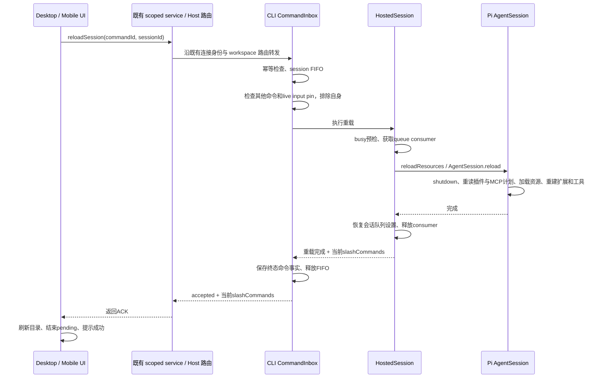

# 当前会话资源重载

## 行为与范围

插件安装、卸载、更新、启停后，活跃会话不会自动热替换。插件页提示“已有会话需重载后生效”，会话更多菜单提供“重载当前会话”。重载只作用于当前 session，不终止工作区 Agent、不删除产品会话、不创建新会话或复制历史。

重载成功保留 sessionId、持久历史与当前叶子、模型、思考档位、协作模式、UI 设计开关、followupMode、autoDrain 和输入草稿；SDK reload 后恢复当前会话的 steering/follow-up 队列模式只更新该 Agent runtime，不回写 Pi 全局 settings。成功提示必须等待 SDK 重载和能力目录更新完成。没有 session 的草稿不提供此动作。

## 所有者、接口与边界

- CLI Host 中现有 HostedSession 是唯一运行状态所有者；Pi AgentSession 负责扩展生命周期。UI 只有 pending 展示，不另建队列或运行真相。
- 增加 V4 `reloadSession`，严格空对象 payload；无 CAS（服务端按执行时真实状态决定），沿用 CommandInbox 的 session admission gate、commandId 幂等结果和既有 owner/lease 路由。成功结果为 `{ type: "reloadSession", slashCommands }`，命令 ACK 仅在执行完成后 accepted。
- 共享协议的 legacy 入口导出与 V4 schema 保持一致；不新增旧 `session/close` 或工作区进程重启写路径。
- PiSessionPort 提供 `reloadResources()`；SDK adapter 使用 AgentSession.reload()，不手写扩展 shutdown/start、工具注册或 UI 重绑流程。每次完整 reload 都重新计算 PiCode 插件计划及额外路径，通过公开 ResourceLoader 接口复用同一底层 loader，使 SDK 原有扩展缓存失效语义继续生效；额外路径由适配器持有的构造参数数组更新，不读写 SDK 私有字段。新插件计划仅在底层 loader 本轮 reload 成功后提交；失败不得让旧资源使用未完成的新计划。resources_discover 始终应用最近一次加载完成的计划，资源过滤只由此适配器维护。SDK reload 负责使旧 runtime 的事件订阅失效，保留的 process bridge 在每轮重建后仍只能响应一次事件。
- 每次完整 `AgentSession.reload()` 都在 inline extension factory 执行前重读 `mcpCompat.runtimeServers()` 和 lazy Chrome 配置；factory、懒启动配置和系统提示都使用本轮快照。创建时没有 lazy Chrome 配置也要允许后续完整 reload 加入；删除、禁用或修改后不得沿用旧 server/启动参数/提示。SDK 后续的 `extendResources()` / `resources_discover` 只扩展本轮已加载的资源，不重新读取这两类配置。连接生命周期仍由 SDK 扩展 shutdown/start 管理，不新增 Host 连接所有者。
- CommandInbox 是命令与已接纳输入 pin 的唯一所有者。执行 reload 前检查其他命令和 live input pin（排除 reload 自身的 commandId）；即使 Host 已空闲、输入队列为空，SDK 已接纳但持久化对账未完成的输入仍拒绝重载。不能直接用包含自身 in-flight 的查询判忙。
- HostedSession 重载必须取得现有 HostQueue consumer，并复用真实 residency busy 判据：streaming、compaction、非 idle、分支总结、队列、活动工作、后台进程/子代理、pending interaction、协议 finalization 中任一存在均拒绝。consumer 贯穿异步 reload，使 drain 或其他输入不能越过，并作为 residency busy 事实阻止常驻池在重建期间回收实例。
- SDK reload 会同步自身队列模式；adapter 需在重载后恢复会话当前队列模式，避免读回默认配置覆盖运行时选择。
- 重载成功更新 slash command 目录，已有 session 的技能/工具查询读新的资源表。UI 对目录请求失效/重新读取，迟到结果按原有请求序列丢弃。
- workspace 定位沿用 workspaceIdentity?.trim() || workspacePath；remoteSessionId 与 workspaceIdentity 通过现有 scoped services/transport 传递，不另造本地快捷路径。

Desktop `desktop-continuous` 继续使用原订阅和 sequence；Mobile `web-remote-replayable` 继续使用原 snapshot/gap repair。重载不销毁 publisher、不切 logEpoch、不发布 session.removed，不依赖客户端重订阅恢复。

## 失败语义

- 忙时在第一个 SDK 副作用前失败，返回稳定 reasonCode `guard.sessionReloadBusy`，UI 显示稍后重试原因。
- 不支持资源 reload 的 session 返回 `fault.command.sessionReloadUnsupported`，不降级为工作区重启。
- SDK 执行失败或 `ResourceLoader.getExtensions().errors` 非空时返回 `fault.command.sessionReloadFailed` 和错误原因，不提示成功。该数组包含扩展加载/初始化失败以及工具、命令、flag 冲突诊断；显式重载有意将所有此类诊断视为失败，即使 SDK 仍保留并加载了冲突扩展。SDK 可能只把扩展初始化异常写入诊断而不 reject，adapter 必须检查公开加载结果。旧扩展可能已失效，因此记录资源重载失败状态，拒绝后续 prompt、steer/follow-up、模型/思考档位/队列模式切换、工具 loadout 变更、compact、树导航及分支总结等会驱动模型或扩展 runtime 的操作；只读查询与 abort/cancel 仍可用。允许用户再次重载，重载成功清除该状态。不得继续将半初始化 runtime 当作正常可用。
- duplicate commandId 复用原 ACK，不再次重载；再次尝试使用新的 commandId。终态通过现有持久命令事实保存（含 slashCommands 结果或失败 reason），内存 LRU 淘汰或会话回收后仍能查询并恢复；不为重载另建幂等表。持久事实存储必须同时实现 `saveSessionEntry` 与 `sessionEntries`，缺少任一能力均按 `fault.command.persistentFactStoreUnavailable` 处理，不得把只写不可回读的 ACK 当作 durable。
- 持久化失败时 RPC 报错并释放 FIFO，保留真实的内存执行结果；已完成的 SDK 重载不回滚。写入未成功的结果不承诺跨回收/重启恢复，客户端不得据存储错误自动以新 commandId 重试。
- 不自动取消用户任务、清空已接纳输入或加入定时刷新。

## 验收场景

1. 打开持久会话后安装技能/扩展：重载前不出现，重载后目录与下一次模型请求包含新能力；sessionId、历史、叶子、模型/档位不变。
2. 卸载资源并删除文件：重载后不再暴露旧技能/工具；启停使用最新 PiCode 开关，强制包含路径随之变化。同一路径的扩展代码更新后执行新代码，不得命中上一轮 factory 缓存。
3. 已选择 guide 或暂停自动消费：重载后保留选择；协作模式、设计开关、输入草稿不变。
4. running、compacting、pending interaction、queue、background work、child 或 consumer 被占用时拒绝，无 shutdown；已接纳但尚未完成持久化对账的输入 pin 也必须拒绝；并发输入不能穿越重载的 consumer/session gate。
5. SDK 失败时 ACK failed，发送输入被阻止，重新重载成功后可继续使用；不影响同工作区另一会话。
6. 同 commandId 重试只执行一次；内存记录淘汰或回收后可恢复已保存的 ACK 及结果；原桌面/手机订阅持续接收后续消息，无 session.removed、epoch更换或历史重复。
7. 菜单键盘可达、pending 防重复、失败显示原因；插件页对安装/卸载/更新/启停提供已有会话需重载提示，中英双语。菜单提交时携带当前 `sessionId`；该会话已切换或消失时不执行动作，也不得回退为 workspace process restart。
8. 会话创建后新增、修改、删除/禁用插件 MCP 和 lazy Chrome 配置：重载后按最新 server 列表和启动参数注册，提示词同步更新；创建时为空也能新增。重载不提前拉起 lazy Chrome，删除或禁用的 server 不因旧 factory 复活。reload ACK 表示 SDK 已按最新配置重建资源并完成同步扩展初始化，不表示 MCP server 已连接；Pi MCP 扩展在 `session_start` 后异步建立连接，连接中、认证需求或连接失败由其既有状态与诊断机制报告，不改变本次 reload ACK。

验证包含 SDK/Host 行为测试、协议真实链路集成场景，以及菜单与插件提示交互场景。执行 root 和 CLI 的 typecheck、lint 及架构检查；环境缺失的交互验证如实报告。
