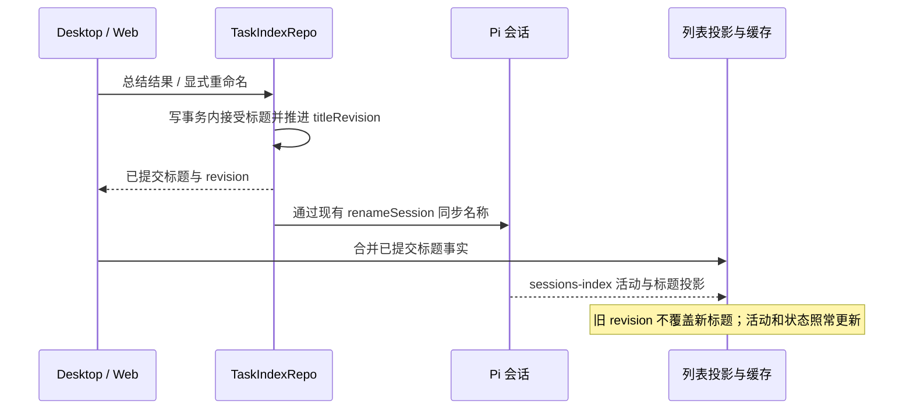

# 会话标题一致性

## 行为与所有者

- 总结标题沿用 `summarizeTaskTitle → renameTask`；显式重命名和总结成功后的标题由 TaskIndexRepo 接受并持久化。Pi `session_info.name` 保存 CLI 会话名称，sessions-index、Controller 和 Renderer 为读投影。
- 当前产品中的用户重命名入口统一调用 task service 的 `renameTask`。底层 `renameSession` 是名称同步原语；绕过 TaskIndexRepo 的 native/外部 session 改名不带 revision，不能证明比已确认的 app 标题更新，也不会覆盖它。本规则不承诺排序这些独立写入。
- 已确认的显式标题不能被旧列表结果、旧 session custom 标题、后续活动时间或较早的 pin/archive 响应覆盖。新的显式重命名仍可替换它。
- `updatedAt` / `lastActivityAt` 只描述活动与排序，不裁决两个已确认标题的新旧。TaskIndexRepo 在写事务内为显式标题分配独立、递增的 `titleRevision`，随现有 `meta_json` 保存；标题、覆盖标记和 revision 必须一起投影和合并。
- 缺少 `titleRevision` 的历史记录按 revision 0 兼容，第一次显式命名建立 revision；不回填历史活动时间，不新增 SQLite 标量列，不迁移会话文件。未显式命名的自动标题保持现有实时更新行为。
- workspace 隔离仍使用 `workspaceIdentity?.trim() || workspacePath`，revision 仅在同一 task 实体内比较；Desktop、Web 与远端共用服务端事实，不在 Renderer 另建标题事实库。

## 历史列表读取

- 大型 JSONL 的内容摘要可保持 1 MiB 的内存预算，但最新会话名称不能受文件头读取上限影响。
- 冷列表与完整恢复必须识别同一条最新有效 `session_info.name`；名称在大消息之前、之后、跨读取块或距离文件尾超过 1 MiB 时都成立。
- 保持现有有效名称清洗、控制命令过滤、活动时间、会话 id、分叉和 active branch 语义。禁止通过整文件载入或无限增长的单行缓冲解决大文件问题。
- 文件不存在、读取失败与半写入尾行沿用现有容错；不把不完整或非法名称当作新的有效标题。

## 列表与缓存合并

- 所有携带 revision 的标题必须按 revision 合并，不能在 whole-meta 的时间或长度选择中丢失较新标题。revision 的比较不改变 phase、pending interaction、activity、pin/archive/unread 或分组排序。
- 同一实体在 active/pinned/archived 并行读取或 endpoint 求并时重复出现，完整行中的标题三元组按 revision 选择；旧字符串标题 map 仅用于无版本数据的兼容，不能覆盖或套用正版本。
- 正 revision 相同则保留调用点的 preferred 候选，不用活动时间推断新旧；正常单一所有者写入中，同一 revision 对应同一标题。同名重复提交保持幂等，但 legacy 同名首次确认仍建立版本。
- 旧 sessions-index custom 投影不能击败 task-index 中较新显式标题；无 revision 的旧数据保持既有规则。
- 查询重发、同版本列表缓存发布以及 membership mutation 回包均不能使较新标题回退。pin/archive 只更新自己的字段。
- `desktop-continuous` 仍直接摄入实时投影；`web-remote-replayable` 的 snapshot / replay / gap repair 继续遵守相同标题比较规则，不改投递协议、owner/lease 或队列语义。

## 验收

1. 文件超过 1 MiB，旧名称在头部、新名称在其后：冷列表和完整恢复都返回新名称；新名称后再追加超过 1 MiB 内容，结果不变。
2. 名称位于读取块边界，包含中文，尾部有不完整 JSONL：仍返回最后一条完整有效名称。
3. 总结提交 revision 1 后，旧 custom session 标题携带更晚活动时间到达：标题保留总结，活动和状态更新。
4. 新标题已进入查询缓存，较早读取的列表结果随后发布：标题不回退；普通自动标题仍能更新。
5. 总结后较早的 pin/archive 响应到达：成员关系更新，新标题和 revision 保留。
6. 再次显式重命名推进 revision；重复同一标题不产生虚假标题变更。旧快照同步、状态、模型和未读写入以及进程重开均保留 revision。
7. 同路径不同远端 identity 的标题互不影响；相同 task 的 revision 在并发 Repo 写入下保持单调。
8. 并行分区或 endpoint 返回重复 task 行，遍历次序不改变最高 revision 的标题；legacy 字符串 map 不会把旧标题附到新 revision 上。
9. Controller 首次聚合期间，active 先返回 revision 2，较早读取的 pinned/archived 后返回 revision 1：首次投影仍保留 revision 2 的标题，membership 和其他字段沿用既有分区优先级。
10. Controller 搜索行与缓存投影分别携带不同 revision 时，返回较高版本的完整标题三元组，活动字段仍沿用既有投影，搜索片段保留。

## 交互回归场景

在项目列表对会话执行“总结标题”，等待总结完成；随后继续运行会话、刷新列表，切到置顶列表再回到项目，最后重新打开会话。每一步都应显示已确认的总结标题。延迟返回旧置顶结果时仍应保持该标题；再次显式重命名应立即显示新名称。

以服务端/状态单测覆盖精确事件顺序，并以复用真实总结入口、列表合并和缓存的页面夹具检查上述标题交互。页面夹具使用合成服务响应；真实模型请求、完整桌面切换和手机远端链路的验证情况在交付时单独报告。
